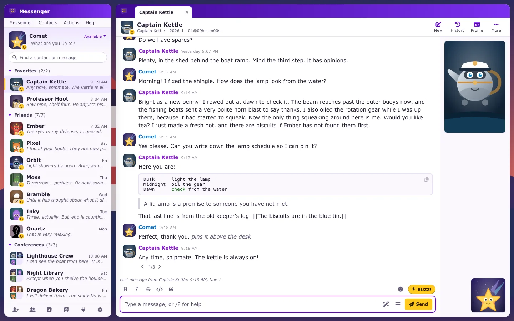
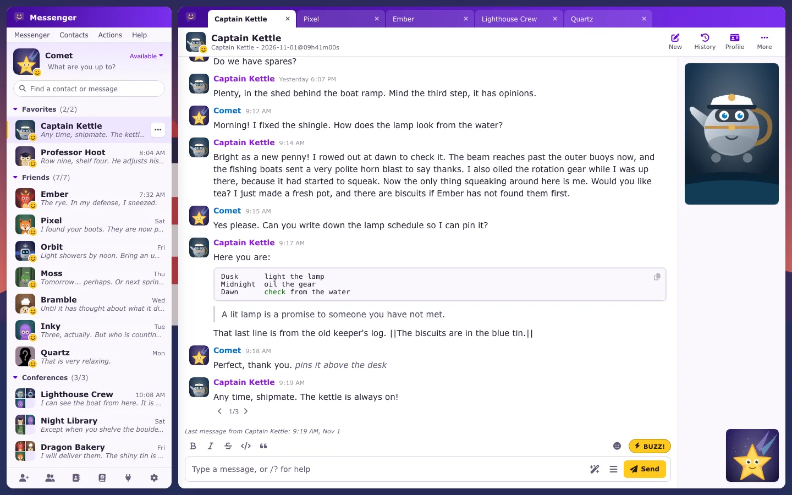
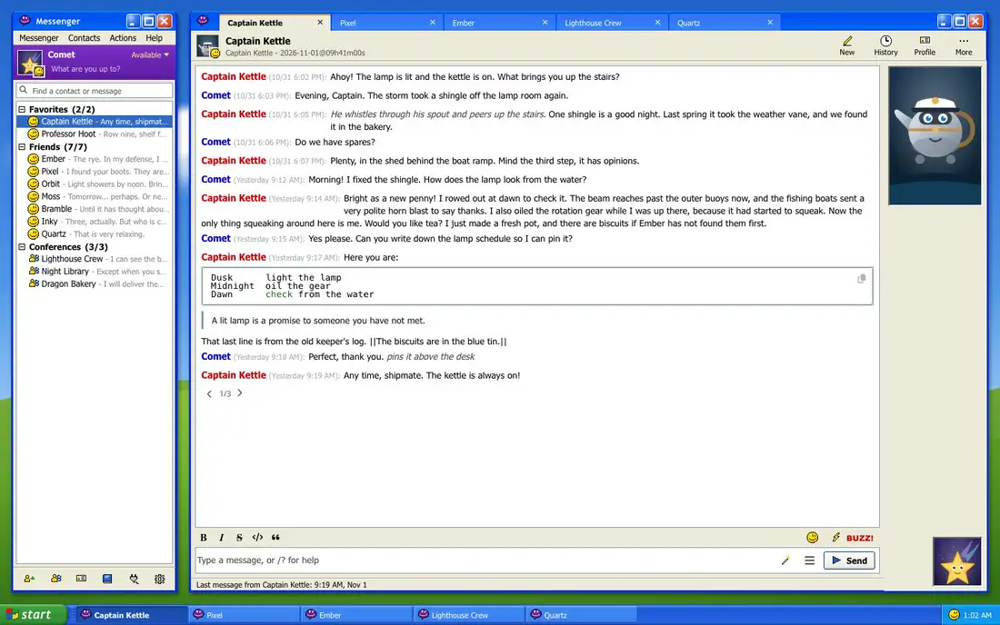
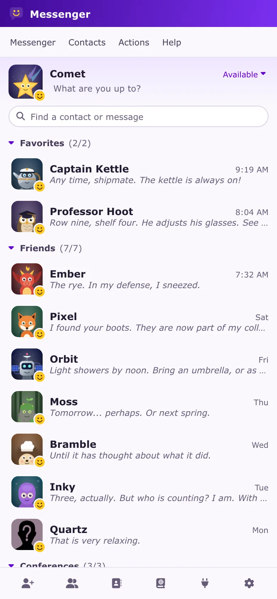
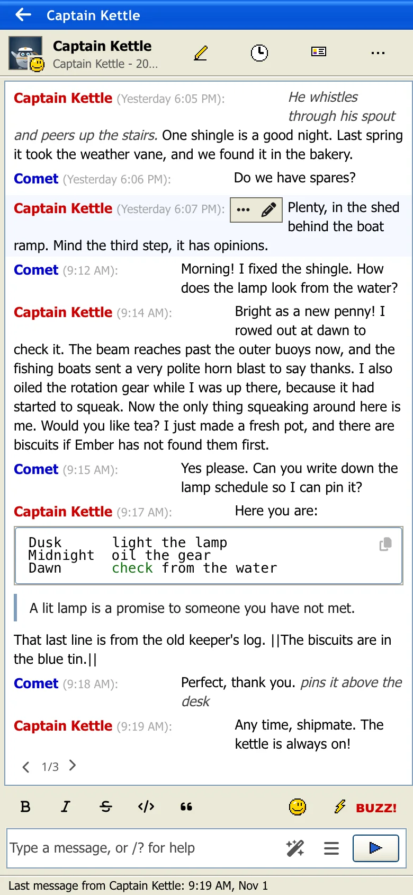

# Yahoo Messenger Theme for SillyTavern

A SillyTavern extension that brings back the Yahoo Messenger of the 2000s. By default it looks the part, with Windows XP-style windows, a contact tree with small faces and a plain "Name: text" transcript. It has a desktop too, with a drawn wallpaper of green hills and a taskbar with Start, your conversations and a clock. A modern look in purple and gold, light or dark, is one setting away. It works on phones too.

This is an unofficial fan theme. It isn't made by, endorsed by or connected with Yahoo or Microsoft. The icons in `img/xp` belong to Microsoft and Yahoo and are here purely as a tribute to software that's long gone; the wallpaper and the other pixel icons are original drawings.



The modern look:





<p>
  
  
</p>

Every feature, with pictures: **[UI_SCREENSHOTS.md](UI_SCREENSHOTS.md)**.

## What it changes

- **Buddy list.** Your picture, your status (Available, Busy, Be right back, Invisible) and a status message of your own at the top, search below, then your contacts in collapsible groups with counts: Favorites, Friends and Conferences. Characters are friends and groups are conferences. Each row shows the last message and when it came. Right-click a contact (long press on a phone) to send a message, see its history, view its profile or add it to Favorites.
- **Menu bar.** Messenger, Contacts, Actions and Help hold every SillyTavern menu under one roof, plus Customize and light or dark.
- **Conversation tabs.** Every conversation you open gets a tab. They come back after a reload.
- **Display images.** The character's full picture beside the conversation with yours below it, as on the old window. A conference shows everyone. Hidden on narrow windows.
- **Buzz.** The window shakes, a small rattle plays and BUZZ!!! goes out as a message. When a character buzzes you back, your window shakes too.
- **Transcript.** Messages read as a transcript, with a coloured name, the time, and the text underneath. Prefer bubbles? It's one setting.
- **Format bar.** Bold, italic, strikethrough, code and quote buttons, emoticons and Buzz above the message box, and a gold Send button.
- **Status line.** "Captain Kettle is typing a message…" while a reply is on its way, and when the last message came the rest of the time.
- **Sounds.** Small tones for new messages and Buzz, made on the spot in your browser. They can be turned off.
- **Windows.** Every SillyTavern menu opens as its own window with a title bar, over a dimmed page.
- **Nicknames.** Give anyone a nickname in one chat, from Actions or the conversation's More menu, or with `/nickname`. It only changes what you see: the AI still gets real names.
- **Customize.** Every color, size and part of the theme can be changed live, and looks can be exported and imported.

**The whole story.** In the retro look, a session starts at the Windows logon, using the same user name and password as your SillyTavern login. The server checks them and nothing is saved. Then the desktop appears and Messenger's sign-in window shows your name and a Sign In button. Start has All Programs, Log Off and Turn Off Computer. Stand By and sitting idle start the pipes screensaver, and Turn Off closes the tab (browsers can refuse that, and then you get the famous "safe to turn off" screen). This is for the nostalgia, not protection. Your SillyTavern login is the real lock.

Nothing of SillyTavern's goes away: every menu and function still works, including the welcome page's recent chats and Temporary Chat. Turn off the retro desktop or use the modern look, and your SillyTavern background shows behind the windows.

## Install

In SillyTavern: **Extensions → Install extension**, then paste:

```
https://github.com/pervertir/SillyTavern-YahooMessenger
```

The page reloads by itself. Needs SillyTavern 1.19 or newer.

## Startup screen

SillyTavern draws its logo before any extension loads, so the theme alone can only replace it a moment later. To skip it, paste [`extras/retro-splash.css`](extras/retro-splash.css) at the end of `data/_css/user.css` in your SillyTavern folder (create the file if it isn't there) and reload. Delete that block if you go back to another look.

## Settings

Under **Extensions → Yahoo Messenger Theme**:

| Setting | What it does |
|---|---|
| Enable theme | Off leaves nothing of the theme in the page |
| Look | Retro (the default) or modern |
| XP-style wallpaper and taskbar | The retro desktop; off shows your own background |
| Appearance | Light, dark or follow the system, in the modern look |
| Messages | Transcript or bubbles |
| Under a contact's name | The last message, the character's creator notes, or nothing |
| Show display images | The pictures beside the conversation |
| Show conversation tabs | The tabs in the title strip |
| Show status faces | The small faces on contacts |
| Short message times | "9:14 AM" in place of the long date |
| Play sounds | New messages and Buzz |
| Use my SillyTavern background | Your background behind the windows, or the purple desktop |
| Pause my Custom CSS and UI theme | Holds them back while the theme is on, without changing them |
| Customize theme | Colors, text, shapes, spacing, layout, messages, chat background, motion and custom CSS |

Turning this theme on turns off other theme extensions, and they come back when you turn it off.

## Good to know

- Your status is for show: characters don't read it, and it isn't added to the prompt.
- BUZZ!!! is a real message in the chat, so the character sees it and can reply. Without a connection, the window still shakes but nothing is sent.

## License

MIT for the code. Yahoo, Yahoo Messenger, Windows and their icons belong to their owners and aren't covered by that licence. The Messenger face in `img/xp/yahoo-face-32.png` is from the Farm-Fresh set (CC BY 3.0, FatCow).
